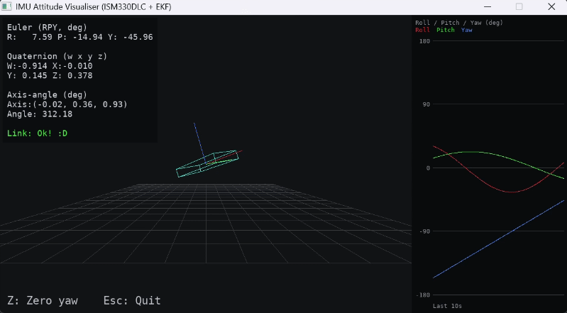
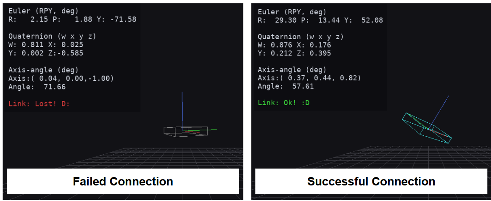
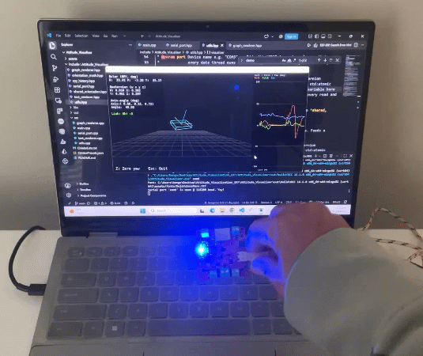
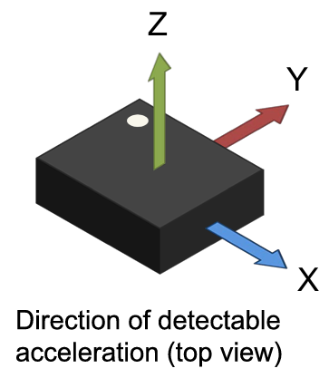

# Purpose
The `Attitude_Visualiser` application reads orientation data from the ESP32 board and renders the orientation of the board on the visualiser in real-time.

>[!IMPORTANT]
>Ensure that the ESP32 board is flashed with the `ekf_imu_app` firmware in `Read_IMU`. `ekf_imu_app` outputs orientation data in the form "QUAT,\<w>,\<x>,\<y>,\<z>", which is the requiried serial data format for `Attitude_Visualiser` to parse the quaternion data (see `parse_quat_line()` in `utils.hpp` for further information). Using `raw_imu_app` instead of `ekf_imu_app` will result in a "Link: Lost" status on the visualiser.

# Running the Application
The built application be can run in two different modes:
1. **Demo Mode.** Use this mode to test whether the visualiser runs properly without any hardware. The attitude visualiser will render the board's orientation using pseudo-evolving rotation data.
2. **Serial Reader Mode.** Use this mode when you want the visualiser to render the board's orientation based on actual data from an IMU.

## Demo Mode
To run in demo mode, run the project executable without specifying any hardware port in the terminal.

``` cmd
# Change to the build directory before running the project executable
cd <path to build directory with project executable>

# Run Windows executable:
Attitude_Visualiser.exe

# Run Linux executable:
./Attitude_Visualiser
```

<div align="center">
  
</div>

## Serial Reader Mode
To run in serial reader mode, specify the hardware port in the terminal. 
``` cmd
# Windows Example:
Attitude_Visualiser.exe COM3

# (Optional) you may also specify the desired baud rate
Attitude_Visualiser.exe COM3 115200

# Linux Example:
./Attitude_Visualiser /dev/ttyUSB0
```

The link status and board colour will show whether you are receiving orientation data from the ESP32. If the connection failed, close the window and run the terminal command again to reattempt a new connection. 

<div align="center">
  
</div>

### Zeroing the Yaw
In serial reader mode, the yaw gradually drifts because there is no absolute reference for the heading (roll and pitch have gravity as their reference). Hence, over time, the heading of the physical IMU may not longer match what is shown on the visualiser.

To zero the yaw, orient the IMU such that its +X axis is pointing the the right of the screen, while its +Y axis is pointing into the screen. Then, press "Z" on the keyboard:

<div align="center">
  
</div>

For reference, according to [STMicroelectronics's datasheet](https://www.st.com/en/mems-and-sensors/ism330dlc.html), the ISM330DLC IMU follows the coordinate system below:

<div align="center">
  
</div>

The direction of positive rotation follows the right-hand rule: the positive rotation follows the curl of the fingers when your right thumb points in the positive axis direction. Note that in the visualiser, the X-axis is red, Y-axis green, and Z-axis blue.

# Folder Structure
This is the project directory for `Attitude_Visualiser`:
```
Attitude_Visualiser/
├── assets/
│   └── fonts/
│       ├── DejaVuSansMono.ttf       # Font file for the fonts used for the visualiser's labels
│       └── LICENSE                  # Third-party license for font asset
├── include/
│   └── Attitude_Visualiser/
│       ├── graph_renderer.hpp       # Draws the time-series graph from rpy_history
│       ├── orientation_math.hpp     # Dependency-free quaternion/vector math implementation
│       ├── rpy_history.hpp          # Rolling time window buffer to historise roll, pitch, and yaw values
│       ├── serial_port.hpp          # Wrapper to handle OS serial communications on Windows and Linux
│       ├── shared_orientation.hpp   # "Mailbox" to manage data handoff between the data parsing thread and drawing thread 
│       ├── text_renderer.hpp        # Manage SDL3_ttf assets for text rendering
│       └── utils.hpp                # Helper functions/variables to parse quaternion data, draw visualiser, and render the HUD
├── src/
│   ├── graph_renderer.cpp
│   ├── main.cpp                     # Entry point for main SDL app
│   ├── serial_port.cpp
│   ├── text_renderer.cpp
│   └── utils.cpp
├── CMakeLists.txt                   # Project-level CMakeLists with automatic dependencies download and post-build configurations
├── CMakePresets.json
└── README.md
```

# Project Dependencies
This project uses the following dependencies:
- [SDL3 3.4.16](https://github.com/libsdl-org/SDL/releases/tag/release-3.4.16) for rendering the attitude visualiser frames.
- [SDL3_ttf 3.2.2](https://github.com/libsdl-org/SDL_ttf/releases/tag/release-3.2.2) for rendering fonts.

The project-level `CMakeLists.txt` calls `FetchContent_MakeAvailable()` to automatically download the above dependencies into a new `libs/` subdirectory during compilation. 

>[!IMPORTANT]
>If you are running `Attitude_Visualiser` on Linux, you may need to manually download additional dependencies. For example, Ubuntu requires X11 and/or Wayland development files to manage SDL3 GUIs. The [SDL3 Readme-Linux page](https://wiki.libsdl.org/SDL3/README-linux) explains how to download the specific dependencies for different Linux distros.
>
>I intentionally left the download of these additional dependencies to be a manual process for user safety; package installs on Linux require root access (i.e. running `sudo` commands) and the relevant packages differ based on distros.

## Post-build Configurations
Once the project executable `Attitude_Visualiser.exe` has been built, the project level `CMakeLists.txt` will run several post-build configurations.

First (for Windows devices only), the code block below copies `SDL3.dll` (obtained from building the SDL3 library) and `SDL3_ttf.dll` (obtained from building the SDL3_ttf library) to the same directory as `Attitude_Visualiser.exe`. This ensures that `Attitude_Visualiser.exe` can locate both files at runtime. 

```CMake
if(WIN32)
    add_custom_command(TARGET ${PROJECT_NAME} POST_BUILD
                       COMMAND ${CMAKE_COMMAND} -E copy_if_different
                       $<TARGET_FILE:SDL3::SDL3> # generator expression that resolves at build time to the actual path of SDL3.dll
                       $<TARGET_FILE:SDL3_ttf::SDL3_ttf> # generator expression that resolves at build time to the actual path of SDL3_ttf.dll
                       $<TARGET_FILE_DIR:${PROJECT_NAME}>   # generator expression that resolves at build time to the actual directory of Attitude_Visualiser.exe
                       COMMENT "Copying SDL3.dll and SDL3_ttf.dll to the same directory as Attitude_Visualiser.exe")
endif()
```

Following this, the next code block copies the `assets/fonts` directory to the same directory as `Attitude_Visualiser.exe`. This ensures that `init()` in `text_renderer.hpp` can locate the font assets when initialising the SDL3_ttf assets.

```CMake
add_custom_command(TARGET ${PROJECT_NAME} POST_BUILD
                   COMMAND ${CMAKE_COMMAND} -E copy_directory
                   ${CMAKE_CURRENT_SOURCE_DIR}/assets
                   $<TARGET_FILE_DIR:${PROJECT_NAME}>/assets
                   COMMENT "Copying assets/fonts to the same directory as Attitude_Visualiser.exe")
```

>[!NOTE]
>`.dll` and `.so` are shared library files native to Windows and Linux respectively. These library files get loaded at runtime and differ in the way they are found. On Windows, the loader (aka dynamic linker) checks the `.exe`'s folder for `.dll` files to link. This is why the above post-build configuration copies the `.dll` files to the same directory as `Attitude_Visualiser.exe`. On Linux, CMake generates an RPATH that is stored in the project executable. The loader then reads this RPATH to find the directories for the built `.so` files. As such, the project executable is able to find the `.so` files even if they are not in the same directory.
