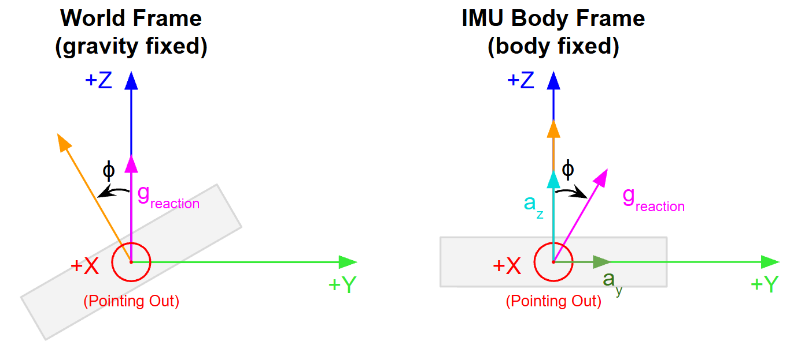

# Introduction
In `Read_IMU`, `ekf_imu_app` implements a quaternion-based EKF to fuse the IMU's gyroscope and accelerometer data for attitude estimation:
- **Gyroscope.** The gyroscope provides angular velocity readings that accurately capture short-term rotation. However, the gyroscope lacks a stable neutral state and reference for its readings. This makes it prone to "gyro drift", a phenomenon where measurement errors accumulate over time.
- **Accelerometer.** The accelerometer is the opposite of the gyroscope. While a single accelerometer signal is noisy (due to the way its proof mass is held in typical MEMs sensors), the long-term average signal of an accelerometer is stable because the downward pull of gravity acts as a permanent external reference. This means the accelerometer readings can be used to periodically pull the absolute roll and pitch angles back to a gravity-driven reference.

>[!NOTE]
>The EKF in `ekf_imu_app` does not compensate for yaw drifts. The downward pull of gravity with respect to the body's Z-axis does not change regardless of the yaw angle i.e. the system lacks an absolute reference for the yaw. That said, the yaw has been included in the EKF state model to support future integration of yaw-correcting sensors (like a magnetometer that returns absolute heading).

# Attitude Estimation
Attitude estimation describes the orientation of a body in 3D space. This project uses quaternions to run the EKF calculations. The attitude visualiser itself displays the roll, pitch, and yaw values in degrees. 

## Quaternions 
Quaternions are four-dimensional complex numbers used to represent orientation in 3D-space. They are usually expressed as:

$$
q = w + xi + yj + zk
$$

With the following properties:
- $w$, $x$, $y$, and $z$ are real numbers.
  - An equivalent representation used below is $q_{0}$, $q_{1}$, $q_{2}$, and $q_{3}$ for each real number respectively.
- $$i^{2} = j^{2} = k^{2} = -1$$.
- $$ij = k$$, $$jk = i$$, $$ki = j$$, and reversing the order of multiplication negates the result (e.g. $$ji = -k$$).

### Why use quaternions?
1. **Smoother rotation.** Unlike Euler angles which require rotations around three axes in a specific sequence, a unit quaternion defines 3D rotation as a **single** rotation angle around a specified rotation axis (see [axis-angle from quaternions](https://github.com/ben-boozled/Attitude_Visualisation_EKF/blob/main/EKF_Equations.md#axis-angle-from-quaternions)). This allows for smooth interpolation between successive orientations.
2. **Avoids gimbal lock.** Quaternions avoid mathematical singularities like gimbal lock. In Euler angle rotations, if the second rotation in a three-axes sequence rotates by +/-90°, the first and third axes will align, resulting in the loss of an independent rotation dimension.
3. **Computational efficiency.** Quaternion operations are more computationally efficient than rotation matrices (which requires more storage memory) and Euler angles (which requires computationally heavy trigonometric operations). Computational efficiency is especially important when implementing firmware on an embedded system with limited resources.
4. **Coolness factor.** Telling people you calculate four-dimensional imaginary numbers sounds cool.

### Rotation Matrix from Quaternions
For a unit quaternion $q$, the equivalent rotation matrix is:

$$
R(q) = \begin{bmatrix} 1-2(q_{2}^{2} + q_{3}^{2})   & 2(q_{1}q_{2} - q_{0}q_{3}) & 2(q_{1}q_{3} + q_{0}q_{2}) \\\\
                       2(q_{1}q_{2} + q_{0}q_{3}) & 1-2(q_{1}^{2} + q_{3}^{2}) & 2(q_{2}q_{3} - q_{0}q_{1})\\\\
                       2(q_{1}q_{3} - q_{0}q_{2}) & 2(q_{2}q_{3} + q_{0}q_{1}) & 1-2(q_{1}^{2} + q_{2}^{2})\end{bmatrix}
$$

### Axis-angle from Quaternions 
For a given $q_{0}$ clamped to the range [-1,1], the rotation angle $\theta$ is:

$$
\theta = 2 \text{arccos}(q_{0})
$$

If $\theta$ is close to zero (i.e. $q_{0} \approx 1$ or $q_{0} \approx -1$), the rotation angle is undefined and defaults to any unit vector. In `orientation_math.hpp`, the rotation axis defaults to $[1, 0, 0]$. Else, the rotation axis $[x, y, z]$ is calculated as follows:

$$
s = \sqrt{1 - q_{0}^{2}}
$$

$$
x = \frac{q_{1}}{s}, \\: y = \frac{q_{2}}{s}, \\: z = \frac{q_{3}}{s} 
$$

## Roll, Pitch, and Yaw (RPY)
Roll ($\phi$), pitch ($\theta$), and yaw ($\psi$) refer to the rotation angles around the X-, Y-, and Z-axes respectively. `Attitude_Visualiser` also plots historical roll, pitch, and yaw values (converted from quaternions to ZYX Euler angles) since they are more intuitive to visualise than quaternions.

### RPY from Linear Acceleration
In `EKF.cpp`, `initialise_from_accel()` uses the accelerometer readings to initialise roll and pitch on startup. Yaw is initialised to zero as a convention since the accelerometer does not provide any information on the heading.

For ZYX Euler convention, the rotation matrix for conversion from body to world frame is $R = R_{z}(\psi) \cdot R_{y}(\theta) \cdot R_{x}(\phi)$. 

$$
R_{z}(\psi) = \begin{bmatrix} \text{cos}(\psi) & -\text{sin}(\psi) & 0 \\\\
                              \text{sin}(\psi) & \text{cos}(\psi)  & 0 \\\\
                              0 & 0 & 1 \end{bmatrix}
$$

$$
R_{y}(\theta) = \begin{bmatrix} \text{cos}(\theta) & 0 & \text{sin}(\theta) \\\\
                                0 & 1 & 0 \\\\
                                -\text{sin}(\theta) & 0 & \text{cos}(\theta)\end{bmatrix}
$$

$$
R_{x}(\phi) = \begin{bmatrix} 1 & 0 & 0 \\\\
                              0 & \text{cos}(\phi) & -\text{sin}(\phi) \\\\
                              0 & \text{sin}(\phi) & \text{cos}(\phi) \end{bmatrix}
$$

The sensor measures the reaction force to gravity. As such, when the sensor is stationary, the unit vector is [0, 0, 1] in the world frame. To map this unit vector to the body frame, which is what the sensor's measurements are based on, the inverse of $R$ (i.e. $R^{T}$) has to be applied:

$$
\text{acceleration}_{body} = \begin{bmatrix} a\_{x} & a\_{y} & a\_{z} \end{bmatrix}^{T} = R^{T} \cdot \begin{bmatrix} 0 & 0 & 1 \end{bmatrix}^{T}
$$

The above is equivalent to finding the third row of $R = R_{z}(\psi) \cdot R_{y}(\theta) \cdot R_{x}(\phi)$:

$$
\begin{bmatrix} a\_{x} \\\\ a\_{y} \\\\ a\_{z} \end{bmatrix} = \begin{bmatrix} -\text{sin}(\theta) \\\\ 
                                                                                \text{cos}(\theta) \cdot \text{sin}(\phi) \\\\
                                                                                \text{cos}(\theta) \cdot \text{cos}(\phi) \end{bmatrix}
$$

>[!NOTE]
>The above expression for the third row of the rotation matrix in Euler form is equivalent to its quaternion representation covered under the [EKF Update Step section](https://github.com/ben-boozled/Attitude_Visualisation_EKF/blob/main/EKF_Equations.md#update-step-driven-by-the-accelerometer). They only look different because they are built from different parameters (Euler angles vs quaternions). You can verify that they are equivalent by substituting the [RPY to quaternion conversions](https://github.com/ben-boozled/Attitude_Visualisation_EKF/blob/main/EKF_Equations.md#rpy-in-zyx-sequence-to-quaternion) and $\psi = 0$ into the quaternion representation $h(q)$.

#### Roll from Acceleration
Using the result for the body's acceleration in the body frame:

$$
\frac{a\_{y}}{a\_{z}} = \frac{\text{cos}(\theta) \cdot \text{sin}(\phi)}{\text{cos}(\theta) \cdot \text{cos}(\phi)} = \text{tan}(\phi)
$$

$$
\phi = \text{atan2}(a_{y}, a_{z})
$$

$a_{y}$ and $a_{z}$ are linear acceleration values reported in the IMU's frame. In the body-frame, $\phi$ appears to be a clockwise rotation around the x-axis. However, since gravity is fixed in the world frame, this corresponds to an anti-clockwise rotation in the world frame, which equates to a positive roll (based on the right-hand rule) in the world frame.

  

#### Pitch from Acceleration
Similarly for pitch, we need a sine-like and cosine-like quantity for $\theta$ to make $\text{tan}(\theta)$ appear. 

$$
a_{y}^{2} + a_{z}^{2} = \text{cos}^{2}(\theta) \cdot (\text{sin}^{2}(\phi) + \text{cos}^{2}(\phi)) = \text{cos}^{2}(\theta)
$$

Pitch is bounded in the range [-90°, 90°] so that every orientation is defined by exactly one set of Euler angles. Within this range, $\text{cos}(\theta) \geq 0$. Hence, taking the positive square root:

$$
\text{cos}(\theta) = \sqrt{a_{y}^{2} + a_{z}^{2}}
$$

With the above result:

$$
\frac{a\_{x}}{\sqrt{a_{y}^{2} + a_{z}^{2}}} = \frac{-\text{sin}(\theta)}{\text{cos}(\theta)} = -\text{tan}(\theta)
$$

$$
\theta = \text{atan2}(-a_{x}, \sqrt{a_{y}^{2} + a_{z}^{2}})
$$

### Conversion between Quaternions and RPY
A unit quaternion can be converted to the roll ($\phi$), pitch ($\theta$), and yaw ($\psi$) Euler angles, and vice versa. The formula in this section covers the conversion between quaternions and ZYX Euler angles.

#### Quaternion to RPY (in ZYX sequence)

$$
\phi = \text{atan2}(2(q_{0}q_{1} + q_{2}q_{3}), 1-2(q_{1}^{2} + q_{2}^{2}))
$$

$$
\theta = \text{arcsin}(2(q_{0}q_{2} - q_{1}q_{3}))
$$

$$
\psi = \text{atan2}(2(q_{0}q_{4} + q_{1}q_{2}), 1-2(q_{2}^{2} + q_{3}^{2}))
$$

#### RPY (in ZYX sequence) to Quaternion
The reverse conversion is implemented only in `demo_orientation_thread()` under `utils.cpp`. `demo_orientation_thread()` implements the formula below and normalises the result to obtain the unit quaternion.

$$
q_{0} = cos \left(\frac{\phi}{2} \right) \cdot cos \left(\frac{\theta}{2} \right) \cdot cos \left(\frac{\psi}{2} \right) + sin \left(\frac{\phi}{2} \right) \cdot sin \left(\frac{\theta}{2} \right) \cdot sin \left(\frac{\psi}{2} \right)
$$

$$
q_{1} = sin \left(\frac{\phi}{2} \right) \cdot cos \left(\frac{\theta}{2} \right) \cdot cos \left(\frac{\psi}{2} \right) - cos \left(\frac{\phi}{2} \right) \cdot sin \left(\frac{\theta}{2} \right) \cdot sin \left(\frac{\psi}{2} \right)
$$

$$
q_{2} = cos \left(\frac{\phi}{2} \right) \cdot sin \left(\frac{\theta}{2} \right) \cdot cos \left(\frac{\psi}{2} \right) + sin \left(\frac{\phi}{2} \right) \cdot cos \left(\frac{\theta}{2} \right) \cdot sin \left(\frac{\psi}{2} \right) 
$$

$$
q_{3} = cos \left(\frac{\phi}{2} \right) \cdot cos \left(\frac{\theta}{2} \right) \cdot sin \left(\frac{\psi}{2} \right) - sin \left(\frac{\phi}{2} \right) \cdot sin \left(\frac{\theta}{2} \right) \cdot cos \left(\frac{\psi}{2} \right)
$$

# Extended Kalman Filter
The EKF involves the following steps:
1. **Initialise** our belief in the system state.
2. **Predict** the system state at the next time step.
3. **Update** the state with sensor measurements (when they are available).
4. **Repeat** steps 2 and 3 iteratively.

Depending on the sampling rate, multiple predict steps may occur before an update step. An update step may also incorporate measurements from multiple sensors at the same time. 

>[!IMPORTANT]
>The EKF works on the assumption that the system is affected by Gaussian noise, and that there is a known mathematical model for the process. At each time step, the EKF linearises the non-linear system by finding the Jacobian of the non-linear process model and/or the measurement function around the current state estimate. The difficulty of calculating the Jacobian is usually the biggest hurdle to EKF implementation.
>
>As an alternative, I recommend checking out the [unscented Kalman Filter](https://github.com/ben-boozled/Unscented_Kalman_Filter/tree/main) (UKF) which bypasses the need to calculate the Jacobian. There are plenty of literature proving that the UKF is capable of achieving comparable or even better performance than the EKF for estimating non-linear systems.

## Setup
The system state comprises both a state vector and a covariance matrix. In Kalman filters, the state vector defines the exact estimated values (i.e. the mean) of the system parameters while the covariance matrix quantifies the uncertainty (i.e. the variance) around those estimates. The values in the state vector and covariance matrix are initialised with our initial belief in the system state, before being iteratively revised on every Predict and Update step.

For this attitude visualisation project, the state vector is:

$$
x_{7×1} = \begin{bmatrix} q0 & q1 & q2 & q3 & bx & by & bz \end{bmatrix}^{T}
$$

- $q0$, $q1$, $q2$, and $q3$ represent a unit quaternion; $q0$ is the scalar component. These represent the orientation of the body (i.e. the IMU) in 3D space.
- $bx$, $by$, and $bz$ are the gyroscope bias rates (rad/s) in the $x$, $y$, and $z$ directions respectively. These bias rates are modelled as random noise.

The covariance matrix is:

$$
P_{7×7} = \begin{bmatrix} \sigma^{2}_{q0} & cov(q0,q1) & cov(q0,q2) & cov(q0,q3) & cov(q0,bx) & cov(q0,by) & cov(q0,bz) \\\\
                          cov(q1,q0) & \sigma^{2}\_{q1} & cov(q1,q2) & cov(q1,q3) & cov(q1,bx) & cov(q1,by) & cov(q1,bz) \\\\
                          cov(q2,q0) & cov(q2,q1) & \sigma^{2}\_{q2} & cov(q2,q3) & cov(q2,bx) & cov(q2,by) & cov(q2,bz) \\\\
                          cov(q3,q0) & cov(q3,q1) & cov(q3,q2) & \sigma^{2}\_{q3} & cov(q3,bx) & cov(q3,by) & cov(q3,bz) \\\\
                          cov(bx,q0) & cov(bx,q1) & cov(bx,q2) & cov(bx,q3) & \sigma^{2}\_{bx} & cov(bx,by) & cov(bx,bz) \\\\
                          cov(by,q0) & cov(by,q1) & cov(by,q2) & cov(by,q3) & cov(by,bx) & \sigma^{2}\_{by} & cov(by,bz) \\\\
                          cov(bz,q0) & cov(bz,q1) & cov(bz,q2) & cov(bz,q3) & cov(bz,bx) & cov(bz,by) & \sigma^{2}\_{bz} \end{bmatrix}
$$

>[!NOTE]
>The off-diagonal entries (i.e. the covariances) are initialised to 0 because we do not have any information on the correlation between the various errors. These covariances will get filled in as the filter iterates between the predict step (which increases uncertainty) and update step (which decreases uncertainty); the variance and covariance values of $P$ are expected to converge to a steady state value. 

## Predict Step (Driven by the Gyroscope)
The process model in the predict step is driven by the gyroscope's readings. It models the orientation change rate of the body (in this case, the body is the PCB with the IMU) with respect to the world-coordinate system as:

$$
\dot{f} = \dot{x} =  \begin{bmatrix} \dot{q0} & \dot{q1} & \dot{q2} & \dot{q3} & \dot{bx} & \dot{by} & \dot{bz} \end{bmatrix}^{T} = \begin{bmatrix} \dot{q}_{1×4} & 0\_{1×3} \end{bmatrix}^{T}
$$

By taking in 7 state values, this process model returns 7 rates of change. 

- The quaternion component is a unit quaternion (magnitude = 1). It is expressed as:

$$
q = \begin{bmatrix} q0 & q1 & q2 & q3 \end{bmatrix}^{T} 
$$

- The rate of range of the quaternion component is modelled as:
  
$$
\dot{q} = \frac{1}{2}\Omega(\omega)q
$$

- $\Omega(\omega)$ is the quaternion skew-symmetric matrix. This matrix maps the angular velocity vector of a rigid body to the time derivative of its quaternion orientation:

$$
\Omega(\omega) = \begin{bmatrix} 0 & -\omega_{x} & -\omega_{y} & -\omega_{z} \\\\ 
                                 \omega_{x} & 0 & \omega_{z} & -\omega_{y} \\\\
                                 \omega_{y} & -\omega_{z} & 0 & \omega_{x} \\\\
                                 \omega_{z} & \omega_{y} & -\omega_{x} & 0 \end{bmatrix}
$$

- Each $\omega_{x}$, $\omega_{y}$, and $\omega_{z}$ angular velocity term (rad/s) in $\Omega(\omega)$ is computed as:

$$
\omega_{actual} = \omega_{measured} - bias
$$

- The bias term refers to the respective $bx$, $by$, and $bz$ values from the state vector. These terms are included to account for gyroscope drift. As the bias terms are modelled as random noise (i.e. mean 0), they are represented by a 0 vector in the process model.

### State Vector Prediction
Since the sample periods are short (~10ms as the IMU has a data rate of 104Hz), the predicted state vector is calculated by discretising with a first-order time step:

$$
x_{k+1} = x_k + \dot{x} \Delta t
$$

This means that:
- Each component of the quaternion vector, $q_{i}$, is calculated as $$q_{i, k+1} = q_{i, k} + \dot{q_{i}} \Delta t$$. Then, the quaternion is normalised to return a unit quaternion.
- The bias components $bx$, $by$, and $bz$ remain unchanged by the prediction because the bias is modelled as random noise. 

### Covariance Matrix Prediction
The equation for covariance prediction is:

$$
\bar{P}_{k+1} = \Phi P\_{k} \Phi^{T} + Q 
$$

#### Obtaining $$\Phi$$ (Linearised State Transition Matrix)
For a first-order approximation of the continuous process model:

$$
\Phi_{7×7} \approx I_{7×7} + F_{7×7} \Delta t
$$

- F is the Jacobian (the partial derivative of a matrix) of the process model. Computing the Jacobian allows the EKF to linearise the non-linear function $f$ at the current state estimate.

$$
F_{7×7} = \frac{\partial f}{\partial x} =  \begin{bmatrix} \frac{\partial f_{1}}{\partial x_{1}} & \frac{\partial f_{1}}{\partial x_{2}} & \cdots \\\\ 
                                                     \frac{\partial f_{2}}{\partial x_{1}} & \frac{\partial f_{2}}{\partial x_{2}} & \cdots \\\\
                                                     \vdots & \vdots & \ddots \end{bmatrix}
                                        =  \begin{bmatrix} \frac{\partial \dot{q}}{\partial q}\_{4×4} & \frac{\partial \dot{q}}{\partial b}\_{3×3} \\\\
                                           \frac{\partial \dot{b}}{\partial q}\_{3×4} & \frac{\partial \dot{b}}{\partial b}\_{3×3} \end{bmatrix}
$$

**Computing the Jacobian Blocks**

Since the process model sets $\dot{b}=0$:

$$
\frac{\partial \dot{b}}{\partial q}\_{3×4} = 0_{3×4}
$$

$$
\frac{\partial \dot{b}}{\partial b}\_{3×3} = 0_{3×3}
$$

The $\frac{\partial \dot{q}}{\partial q}$ block is obtained by directly differentiating the expression $\dot{q} = \frac{1}{2}\Omega(\omega)q$ with respect to $q$.

$$
\frac{\partial \dot{q}}{\partial q} = \frac{1}{2} \Omega(\omega)
$$

Lastly, since $\Omega(\omega)q$ is linear in both $\omega$ and $q$, we let $\Omega(\omega)q$ = $\Xi(q) \omega$. Hence, $\dot{q} = \frac{1}{2} \Xi(q) \omega$. Differentiating this with respect to the bias, we obtain:

$$
\frac{\partial \dot{q}}{\partial b} = -\frac{1}{2} \Xi(q)\_{3×3}
$$

>[!NOTE]
>The negative sign above comes from the bias term $b$ within  $\omega$, where $\omega_{actual} = \omega_{measured} - b$.

**Putting it all Together**

The linearised state transition matrix is:

$$
\Phi_{7×7} = \begin{bmatrix} 1 & -\frac{1}{2} \Delta t · \omega_{x} & -\frac{1}{2} \Delta t · \omega_{y} & -\frac{1}{2} \Delta t · \omega_{z} & \frac{1}{2} \Delta t · q_{1}                                  & \frac{1}{2} \Delta t · q_{2} & \frac{1}{2} \Delta t · q_{3} \\\\ 
                             \frac{1}{2} \Delta t · \omega_{x} & 1 & \frac{1}{2} \Delta t · \omega_{z} & -\frac{1}{2} \Delta t · \omega_{y} & -\frac{1}{2} \Delta t · q_{0}                                   & \frac{1}{2} \Delta t · q_{3} & -\frac{1}{2} \Delta t · q_{2} \\\\
                             \frac{1}{2} \Delta t · \omega_{y} & -\frac{1}{2} \Delta t · \omega_{z} & 1 & \frac{1}{2} \Delta t · \omega_{x} & -\frac{1}{2} \Delta t · q_{3}                                   & -\frac{1}{2} \Delta t · q_{0} & \frac{1}{2} \Delta t · q_{1} \\\\
                             \frac{1}{2} \Delta t · \omega_{z} & \frac{1}{2} \Delta t · \omega_{y} & -\frac{1}{2} \Delta t · \omega_{x} & 1 & \frac{1}{2} \Delta t · q_{2} 
                                 & -\frac{1}{2} \Delta t · q_{1} & -\frac{1}{2} \Delta t · q_{0} \\\\
                             0 & 0 & 0 & 0 & 1 & 0 & 0 \\\\
                             0 & 0 & 0 & 0 & 0 & 1 & 0 \\\\
                             0 & 0 & 0 & 0 & 0 & 0 & 1 \\\\
              \end{bmatrix}
$$

#### Obtaining Q (Process Noise Matrix)
The process noise matrix represents external disturbances and modelling inaccuracies. It assumes that the noise in each state is uncorrelated with the noise on every other state and hence, takes the form of a diagonal matrix:

$$
Q_{7×7} = \begin{bmatrix} \left( \frac{\Delta t}{2} \right)^{2} \sigma_{gyro}^{2} & 0 & 0 & 0 & 0 & 0 & 0 \\\\
                          0 & \left( \frac{\Delta t}{2} \right)^{2} \sigma_{gyro}^{2} & 0 & 0 & 0 & 0 & 0 \\\\
                          0 & 0 & \left( \frac{\Delta t}{2} \right)^{2} \sigma_{gyro}^{2} & 0 & 0 & 0 & 0 \\\\
                          0 & 0 & 0 & \left( \frac{\Delta t}{2} \right)^{2} \sigma_{gyro}^{2} & 0 & 0 & 0 \\\\
                          0 & 0 & 0 & 0 & \sigma_{bias}^{2} \Delta t & 0 & 0 \\\\
                          0 & 0 & 0 & 0 & 0 & \sigma_{bias}^{2} \Delta t & 0 \\\\
                          0 & 0 & 0 & 0 & 0 & 0 & \sigma_{bias}^{2} \Delta t \\\\
          \end{bmatrix}
$$

- Quaternion noise term: $\left( \frac{\Delta t}{2} \right)^{2} \sigma_{gyro}^{2}$
  - The quaternion noise $\sigma_{gyro}^{2}$ enters the system in discrete time steps, from when each gyroscope reading is polled.
    - Recall that $\dot{q} = \frac{1}{2} \Xi(q) \omega$. Over a single time step, $q_{k+1} = q_{k} + \frac{1}{2} \Xi(q) \omega \Delta t$.
    - Therefore, if $\omega$ measurements are wrong by $n$, the new quaternion will be wrong by $\delta q = \frac{1}{2} n \Xi(q) \Delta t$
  - For random variables, $cov(An) = A cov(n) A^{T}$. 
    - This means $cov(\delta q)$ gives $\left( \frac{\Delta t}{2} \right)^{2} cov(n) \cdot \Xi(q) \Xi(q)^{T}$.
    - To simplify calculations, the code approximates $\Xi(q) \Xi(q)^{T}$ as an identity matrix (i.e. add variance along the diagonals of $q$ and ignore the off-diagonal elements).
  - The overall result simplifies to $cov(\delta q) = \left( \frac{\Delta t}{2} \right)^{2} cov(n)$; the noise term scales by a factor of $\left( \frac{\Delta t}{2} \right)^{2}$.
- Bias noise term: $\sigma_{bias}^{2} \Delta t$
  - The bias noise term $\sigma_{bias}^{2}$ is a continuous white noise with continuous time density.
  - Integrating over a single time step, the resultant noise term scales by a factor of $\Delta t$.

## Update Step (Driven by the Accelerometer)
The measurement model, $h(q)$, is the world-frame gravity unit vector [0, 0, 1] rotated onto the body frame (i.e. $[0, 0, 1]^{T} = R(q) \cdot h(q)$ ). It serves as a ground truth, representing what the accelerometer should read if the IMU is stationary and the current quaternion is correct.

$$
h(q) = \begin{bmatrix} 2(q_{1}q_{3} - q_{0}q_{2}) \\\\
                       2(q_{0}q_{1} - q_{2}q_{3}) \\\\
                       q_{0}^{2} - q_{1}^{2} - q_{2}^{2} + q_{3}^{2} \end{bmatrix}
$$

This model is equivalent to the third row of the [rotation matrix from a unit quaternion](https://github.com/ben-boozled/Attitude_Visualisation_EKF/blob/main/EKF_Equations.md#rotation-matrix-from-quaternions) with the substitution $1 = q_{0}^{2} + q_{1}^{2} + q_{2}^{2} + q_{3}^{2}$.

### Key Matrices for the Update Step
Before updating the state vector and covariance matrix, we need to first calculate several helper vectors and matrices. 

#### Measurement Jacobian
The measurement Jacobian $H$ is evaluated at the current state. It serves as a linear approximation for how changes in each state affect each measurement component. 

$$
H_{3×7} = \frac{\partial h}{\partial x} = \begin{bmatrix} -2q_{2} &  2q_{3} & -2q_{0} & 2q_{1} & 0 & 0 & 0 \\\\
                                                           2q_{1} &  2q_{0} &  2q_{3} & 2q_{2} & 0 & 0 & 0 \\\\
                                                           2q_{0} & -2q_{1} & -2q_{2} & 2q_{3} & 0 & 0 & 0 \end{bmatrix}
$$

#### Residual (Innovation)
The residual, $y$, is the difference between the measured and predicted gravity direction.

$$
y_{3×1} = z - h(x)
$$

Where $z = [ax, ay, az]^{T}$ is the normalised accelerometer reading.

#### Measurement Noise Covariance Matrix, R
The measurement noise covariance matrix, $R$, describes the random error from the accelerometer readings. For a typical MEMS accelerometer, it is assumed there is no correlation between the noises of the different measurements. Hence, $R$ takes the form of a diagonal matrix:

$$
R_{3×3} = \begin{bmatrix}  \sigma_{accel\\_noise}^{2} & 0 & 0 \\\\
                           0 & \sigma_{accel\\_noise}^{2} & 0 \\\\
                           0 & 0 & \sigma_{accel\\_noise}^{2} \end{bmatrix}
$$

The smaller the value of $R$, the more the system trusts the accelerometer measurements. 

>[!NOTE]
>If the sensor datasheet provides noise density data, the noise data should be converted into variance before being added into $R$. Alternatively, the variance of the accelerometer readings along each axis can be determined empirically.

#### Innovation Covariance Matrix, S
The innovation covariance matrix, $S$, aims to incorporate data in a statistically optimal manner based on relative uncertainties. A higher $S$ means the system should be less confident in the measurement from the accelerometer (e.g. $S$ could be higher as there is more measurement noise from $R$). Conversely, a lower $S$ means the predicted measurements align with the sensor readings. Hence, the system should be more confident in the measurements. 

$$
S_{3×3} = HPH^{T} + R
$$

#### Kalman Gain, K
The Kalman gain, $K$, determines how much weight to assign to the measurement versus the prediction when updating the state estimate. When $P$ is large (uncertain state) relative to $R$, $K$ is large and the filter trusts the accelerometer measurements more. Vice versa.

$$
K_{7×3} = PH^{T}S^{-1}
$$

### State Vector Update
Having calculated the Kalman gain, $K$, and residual, $y$, the state vector is updated using the formula below:

$$
x = \bar{x} + Ky
$$

### Covariance Matrix Update
Similarly, the covariance matrix $P$ is updated using $K$ and $H$:

$$
P = (I - KH) \bar{P}
$$
