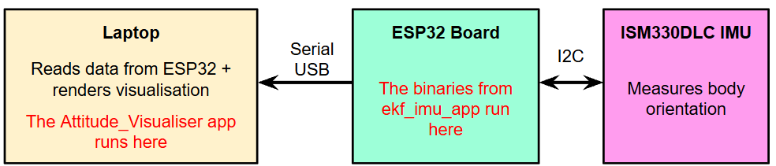

# Project Demonstration
I built an attitude visualiser that shows the spatial orientation of an ESP32 printed-circuit board (PCB) with an ISM330DLC inertial measurement unit (IMU) in real-time. The IMU's measurements are filtered by a quaternion-based extended Kalman filter (EKF) before it is rendered on the visualiser. 

  

>[!NOTE]
>The attitude visualiser has been designed and verified to work on both Windows and Linux. Details on the mathematics behind its implementations are covered in `EKF_Equations.md`.

# Motivation
I had three primary motivations for building an attitude visualiser from scratch:
1. **Sensor verification.** An attitude visualiser ensures that data is being correctly parsed from an IMU. This helps verify IMU measurements before incorporating the IMU (and its firmware) into a larger system.
2. **First-principles understanding.** Building an attitude visualiser from scratch is a good way to revisit the fundamentals of orientation math instead of relying on abstracted library functions.
3. **EKF implementation.** This project also implemented an EKF from scratch. While I am partial towards the [unscented Kalman filter](https://github.com/ben-boozled/Unscented_Kalman_Filter/tree/main) because it bypasses the need to calculate a Jacobian (without compromising performance), the EKF remains widely used in practice; having knowledge of an EKF's underlying functions is still valuable. 

# Project Architecture
The `Attitude_Visualiser_EKF` repository features two sub-projects: `Attitude_Visualiser` and `Read_IMU`. These sub-projects work in tandem to run the overall visualiser: 
1. `Attitude_Visualiser` parses orientation data from the ESP32 board. Using this data, it draws a visualisation of the physical board's orientation in real-time.
2. `ekf_imu_app` of `Read_IMU` runs on the ESP32 board. It reads orientation data from the ISM330DLC IMU, filters the data using an EKF, and converts the filtered data into a format readable by `Attitude_Visualiser`.

  

Details on how to configure, build, and run these sub-projects are available in their respective `README.md`.

# Third-party Licenses
`Attitude_Visualiser_EKF` also uses third-party components that are distributed under their own licenses. The full license texts for these components have been included in their respective sub-directories.

## STMicroelectronics ISM330DLC IMU Driver
The IMU driver files in [`Read_IMU/components/IMU_ISM330DLC`](https://github.com/ben-boozled/Attitude_Visualisation_EKF/tree/main/Read_IMU/components/IMU_ISM330DLC) are provided by STMicroelectronics and licensed under the terms in [`Read_IMU/components/IMU_ISM330DLC/LICENSE`](https://github.com/ben-boozled/Attitude_Visualisation_EKF/blob/main/Read_IMU/components/IMU_ISM330DLC/LICENSE), which is based on the BSD 3-Clause license.

The only modification made to these files is the renaming of the source and header files from `ism330dlc_reg.c` and `ism330dlc_reg.h` to `IMU_ISM330DLC.c` and `IMU_ISM330DLC.h` respectively. The relevant include directives for the IMU driver reflect these name changes. 

## DejaVu Sans Mono Font
The DejaVu Sans Mono Font in [`Attitude_Visualiser/assets/fonts/`](https://github.com/ben-boozled/Attitude_Visualisation_EKF/tree/main/Attitude_Visualiser/assets/fonts) is licensed under the terms in [`Attitude_Visualiser/assets/fonts/LICENSE`](https://github.com/ben-boozled/Attitude_Visualisation_EKF/blob/main/Attitude_Visualiser/assets/fonts/LICENSE), which is based on the Bitstream Vera license.

# Dependency Management
The project dependencies of `Attitude_Visualiser` and `Read_IMU` are covered in their respective `README.md`.
- `Attitude_Visualiser` is built as a standard desktop CMake project for cross-platform compatibility.
- `Read_IMU` is built as an ESP-IDF project because my PCB uses an ESP32-C6-Mini-1 to poll data from the IMU. For C/C++ projects with multiple files like `Read_IMU`, it is also easier to organise the project on ESP-IDF than a simpler development environment like the Arduino IDE.
