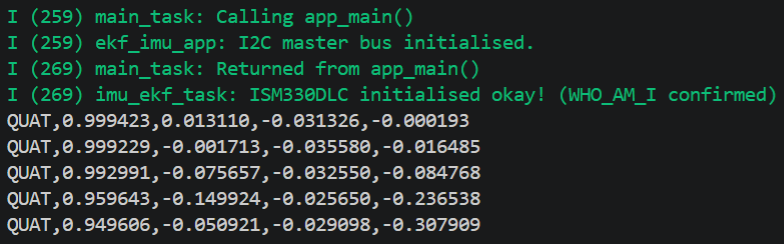
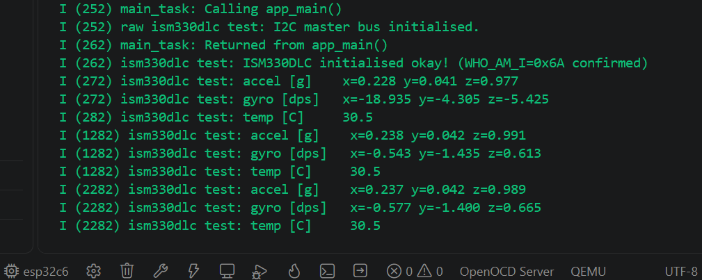

# Purpose
`Read_IMU` generates the binaries for an ESP32 device to read measurements from an ISM330DLC IMU. This project is designed to run in [ESP-IDF](https://www.espressif.com/en/products/sdks/esp-idf), the official development environment by Espressif Systems for their various ESP32 devices. Two different binaries can be built from this project and flashed onto the ESP32 device:
1. **Application #1: ekf_imu_app** (selected by default)
   - This is the application to be used with `Attitude_Visualiser`. It returns the orientation of the IMU in quaternions.
   - The accelerometer and gyroscope readings from the IMU have been fused using an EKF to ameliorate the effects of gyro drift in the roll and pitch (yaw will still drift because there is no absolute heading reference e.g. a magnetometer).  
3. **Application #2: raw_imu_app**
   - This application logs raw accelerometer, gyroscope, and temperature data once every second without any filtering.
   - Use this to test whether your ESP32 device is connected properly to the ISM330DLC IMU.

`Read_IMU` uses a mix of C and C++ code. While the official ESP-IDF APIs are written primarily in C, the matrix calculations performed by the EKF are easier to implement with C++ libraries (see [Project Dependencies](https://github.com/ben-boozled/Attitude_Visualisation_EKF/blob/main/Read_IMU/README.md#project-dependencies)). I have used `.h` and `.hpp` file extensions to differentiate the header files for `.c` and `.cpp` source files respectively.

To modify this project for your own use, read the sections on [Board Selection and I2C Configuration](https://github.com/ben-boozled/Attitude_Visualisation_EKF/blob/main/Read_IMU/README.md#board-selection-and-i2c-configuration) and [Selecting the Build Target](https://github.com/ben-boozled/Attitude_Visualisation_EKF/blob/main/Read_IMU/README.md#selecting-the-build-target).

# Expected Outputs
The outputs from the binaries can be read by connecting the ESP32 device to your computer (via USB) and opening the "Monitor Device" terminal in ESP-IDF.

With full verbosity enabled, `ekf_imu_app` returns the orientation readings represented by a unit quaternion 100 times every second:

<div align="center">
  
</div>

On the other hand, `raw_imu_app` logs raw accelerometer, gyroscope, and temperature data once every second:

<div align="center">
  
</div>

For an IMU that is upright, the **z** value should be ~1g (corresponding to Earth's gravitational acceleration of 9.8m/s<sup>2</sup>).

>[!NOTE]
>The I2C address of the ISM330DLC IMU is **0x6A** (as seen beside the WHO_AMI_I) because the physical ISM330DLC IMU on my board has its SD0 pin pulled to ground. If this pin is pulled HIGH, the IMU's I2C address is **0x6B**. In the latter scenario, the corresponding IMU address macros in `i2c_hal.hpp` and `test_i2c_hal.c` need to be changed from `ISM330DLC_I2C_ADD_L` to `ISM330DLC_I2C_ADD_H` for the I2C to initialise properly.

# Folder Structure
This is the project directory for `Read_IMU`:
```
Read_IMU/
├── .devcontainer/                  # Used by Visual Studio Code to form a consistent development environment inside a Docker container
│   ├── Dockerfile                  
│   └── devcontainer.json           # Configurations for the container
├── apps/
│   ├── ekf_imu_app/                ### Application #1 (default): ESP32 device returns EKF-filtered readings from the IMU
│   │   ├── CMakeLists.txt
│   │   ├── i2c_hal.cpp             # Configures the ESP32 I2C bus and acts as the HAL glue to the ism330dlc driver 
│   │   ├── i2c_hal.hpp
│   │   ├── imu_ekf_task.cpp        # Configures IMU + EKF RTOS task
│   │   ├── imu_ekf_task.hpp
│   │   └── main.cpp                # Application #1 entry point
│   └── raw_imu_app/                ### Application #2: Tests whether the ESP32 device can read data from the IMU
│   │   ├── CMakeLists.txt
│   │   ├── main.c                  # Application #2 entry point
│   │   ├── test_i2c_hal.c          # Configures the ESP32 I2C bus and acts as the HAL glue to the ism330dlc driver  
│   │   ├── test_i2c_hal.h
│   │   ├── test_ism330dlc_task.c   # Configures IMU RTOS task
│   │   └── test_ism330dlc_task.h
├── components/
│   ├── EKF/                        # Extended Kalman Filter for fusing gyroscope and accelerometer readings
│   │   ├── include/
│   │   │   └── EKF.hpp
│   │   ├── CMakeLists.txt
│   │   └── EKF.cpp
│   └── IMU_ISM330DLC/              # Third-party ism330dlc driver from STMicroelectronics
│   │   ├── include/
│   │   │   └── IMU_ISM330DLC.h
│   │   ├── CMakeLists.txt
│   │   ├── IMU_ISM330DLC.c
│   │   └── LICENSE                 # STMicroelectronics license
├── CMakeLists.txt                  # Project level CMakeLists with build configurations for different applications
└── README.md     
```

# Board Selection and I2C Configuration
In my tests, I used a custom PCB based on the ESP32-C6-Mini-1 chip to read data from the ISM330DLC IMU. However, the `Read_IMU` code can be used for any ESP32 chip. You will need to configure the correct Espressif Device Target and SDA/SCL pins for the I2C communication between the chip and the IMU.

## Setting the Espressif Device
On the ESP-IDF extension of Visual Studio Code, the target Espressif device can be edited by clicking the "Set Espressif Device Target" icon along the bottom toolbar:

<div align="center">
  
</div>

## Setting the I2C Pins
On an ESP32-C6-Mini-1 chip, the SDA and SCL pins for I2C communication are GPIO 6 and GPIO 7 respectively. If you are using a device with a different ESP32 chip, the corresponding SDA and SCL pin macros in `i2c_hal.hpp` and `test_hal_i2c.h` need to be edited to the relevant I2C GPIOs for that specific ESP32 chip before building the binaries. The I2C macros for the respective header files are shown below:

For `i2c_hal.hpp`:
```cpp
inline constexpr gpio_num_t sda_pin         = GPIO_NUM_6;   // SDA and SCL GPIOs for ESP32-C6-Mini-1
inline constexpr gpio_num_t scl_pin         = GPIO_NUM_7;
```

For `test_hal_i2c.h`:
```c
#define I2C_MASTER_SDA_IO       GPIO_NUM_6     // SDA and SCL GPIOs for ESP32-C6-Mini-1
#define I2C_MASTER_SCL_IO       GPIO_NUM_7 
```

# Selecting the Build Target
By default, `idf.py build` will compile the binaries for `ekf_imu_app`. The configurations for the terminal commands are in the project level `CMakeLists.txt`. To select a different build target, open the ESP-IDF terminal and enter the commands below:

1. Clean the previous build artifact's cache to avoid configuration conflicts (instead of running the command below, you can also manually delete the `build/` directory).
```cmd
idf.py fullclean
```

2. Compile the binaries for your chosen application.
```cmd
# Compile raw_imu_app
idf.py -DAPP_TARGET=raw_imu_app build

# Compile ekf_imu_app
idf.py build
```

# Project Dependencies
`raw_imu_app` does not require additional dependencies beyond the native built-in components and C standard library in ESP-IDF. These are automatically provided when you install the ESP-IDF framework; there is no need to install them separately.

`ekf_imu_app` requires [Eigen 5.0.0](https://gitlab.com/libeigen/eigen/-/releases/5.0.0) to perform matrix and vector operations for the extended Kalman filter component. `EKF/CMakeLists.txt` has been configured such that when the build target is `ekf_imu_app`, Eigen 5.0.0 will be automatically downloaded into a new `libs/` directory using `ExternalProject_Add()` during the build process.

>[!IMPORTANT]
>In ESP-IDF, CMake works differently; it evaluates `CMakeLists.txt` files twice. During the **first pass** (the early expansion phase), ESP-IDF scans components to evaluate basic configurations and set the target device; the compiler toolchain has not been initialised. During the **second pass** (the final processing phase), ESP-IDF runs the `project()` command in the project-level `CMakeLists.txt` to initialise the compiler toolchain and evaluate component dependencies. 
>
>`FetchContent_MakeAvailable()` is a standard CMake tool used to fetch and integrate third-party dependencies like Eigen. However, it runs during the configuration phase and requires the compiler toolchain to be initialised. This results in a catch-22: third-party dependencies have to exist in the first pass even though they can only be downloaded after the compiler initialisation in the second pass. While `FetchContent_MakeAvailable()` works well for standard desktop CMake projects, it will not work in ESP-IDF due to this dual-pass evaluation method.
>
>To bypass this bamboozling situation (which well and truly bamboozled me for an entire day), the Eigen library is fetched using `ExternalProject_Add()` in `EKF/CMakeLists.txt`. Unlike `FetchContent_MakeAvailable()` which runs at configure time, `ExternalProject_Add()` only downloads and builds third-party dependencies at build time. During ESP-IDF's first pass, `ExternalProject_Add()` tells CMake that the third-party dependency will exist at build time. At build time, which is well after the compiler has been initialised in the second pass, `ExternalProject_Add()` safely downloads and builds the third-party dependency.
